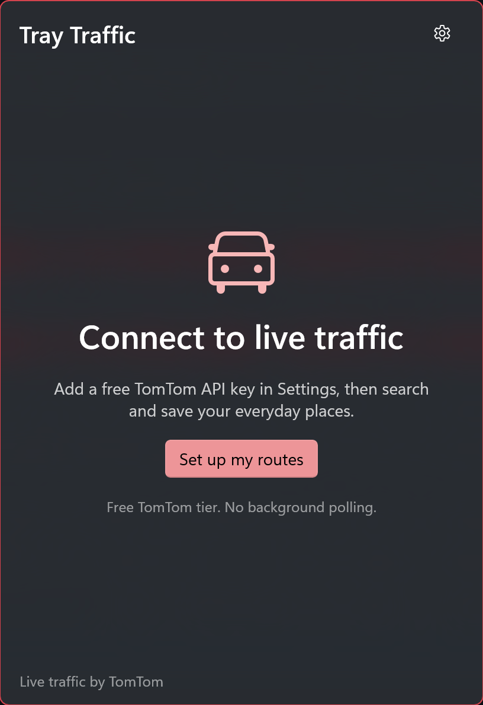
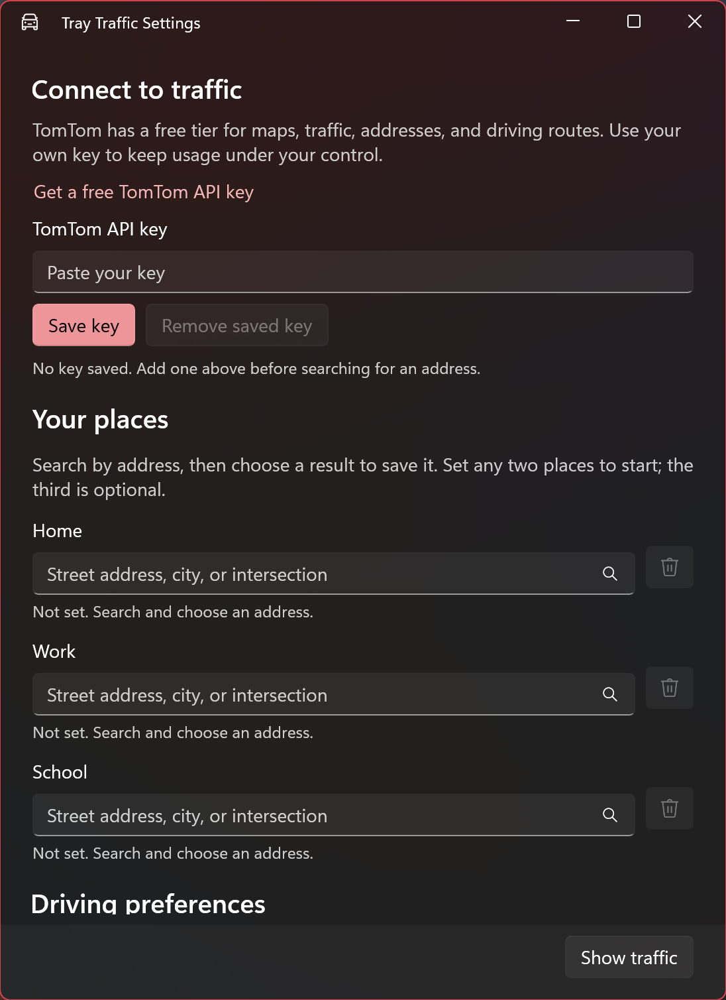

# Tray Traffic

Live traffic and the quickest drive between home, work, and school, one click from the Windows tray.



Tray Traffic is a small, tray-only WinUI 3 app. A click opens a 420 by 600 logical-pixel flyout with traffic-aware travel times, up to three driving routes, and a native traffic map. Click away to dismiss it; there is no main window.

## Features

- Save **Home**, **Work**, and **School** by searching for an address and selecting the correct result. Any two places are enough; the third is optional.
- Turn on **Route** to show the From/To selectors, swap button, route recommendations, and directions. It starts unchecked; turn it off to give the traffic-only map more space.
- Compare the fastest driving route with up to two alternatives. Recommendations are sorted by the actual traffic-aware travel duration, not distance or a free-flow estimate.
- See estimated arrival time, distance, and traffic delay for each route. Selecting an alternative highlights its path; other paths are dashed.
- Pan and zoom a TomTom map with a real-time traffic-flow layer. It starts near the selected starting place and fits the whole commute when Route is enabled and the flyout is laid out, rather than opening at world scale. Green indicates flowing traffic, amber slower traffic, and red congestion. The traffic button toggles the overlay; the fit button is shown only with Route enabled and returns to the selected route.
- Prefer routes without tolls or ferries, and show distances in miles or kilometers.
- Refresh every two minutes **only while the flyout is visible**. Failed requests back off to a maximum of ten minutes. Returning connectivity triggers another attempt.
- Keep the last good result visible when offline or when the service fails.
- Open the trip in Google Maps in the default browser. Google calculates its own route and estimate; this is not turn-by-turn navigation along the selected TomTom path.
- Opt in to Start with Windows. The setting respects user and organization restrictions.
- Theme-aware tray icons, shell-style acrylic, single-instance activation, Escape to dismiss, and an explicit Exit command.

Left-click the tray icon to toggle the flyout. Right-click for **Open Tray Traffic**, **Settings**, and **Exit**. Launching again opens the existing instance instead of adding another icon. Look in the taskbar overflow if Windows hides the icon.

## Traffic provider and cost

**TomTom is the chosen provider; no Azure Maps subscription is needed.** Its current APIs cover the basemap, live traffic-flow tiles, address lookup, and traffic-aware alternative routes.

The [official pricing page](https://docs.tomtom.com/pricing/) was checked on October 2, 2026. It publishes these **monthly, per-API** free allowances:

| API used by this app | Published free monthly requests |
| --- | ---: |
| Map Display raster tiles | 200,000 |
| Traffic Flow and Incidents raster tiles | 200,000 |
| Routing | 20,000 |
| Geocoding | 20,000 |

TomTom advertises free signup without a credit card. Older pages quoting a 50,000-tile/2,500-non-tile **daily** allowance do not describe the current pricing page. Check your account's current plan, permissions, usage, and limits before use; this app does not enforce a billing cap or upgrade your plan.

Address search is explicit (Enter or the search icon), rather than one request per keystroke. Resolved places are saved locally. A normal traffic refresh makes one routing request for the selected pair; map navigation and overlay refresh add tile requests. The app checks basemap and traffic access when initializing a map.

[HERE](https://www.here.com/get-started/pricing) was considered, but its public pricing entry point did not establish a clearer free plan for this complete combination. [Azure Maps](https://azure.microsoft.com/en-us/pricing/details/azure-maps/) is a viable paid/free-allowance alternative, but was not needed and is not an implemented provider in this app. Azure counts map and traffic tile transactions in groups of 15 requests, so its published transaction counts are not directly comparable to raw tile requests.

### Current API versions

This is a new Orbis integration, not an integration with the older `/routing/1` and `/search/2` endpoints:

- [Orbis routing v3](https://docs.tomtom.com/routing-api/documentation/tomtom-orbis-maps/v3/calculate-route): POST `/maps/orbis/routing/routes/calculate`, `routeType=fast`, `traffic=live`, `departureDateTime=now`, and `maxPathAlternativeRoutes=2`. Requested response fields include summaries and leg paths.
- [Orbis geocoding v2](https://docs.tomtom.com/geocoding-api/documentation/tomtom-orbis-maps/v2/geocode): address search with up to five results; a road access point is preferred over a building centroid.
- [Orbis raster basemap v2](https://docs.tomtom.com/map-display-api/documentation/tomtom-orbis-maps/v2/raster/raster-tile): light/dark street tiles.
- [Orbis traffic flow v2](https://docs.tomtom.com/traffic-api/documentation/tomtom-orbis-maps/v2/traffic-flow/raster-flow-tiles): light/dark transparent flow tiles.

Coverage and live traffic availability vary by region. Alternative routes are only shown when TomTom returns them. Travel times are estimates for departing at the request time; they are not guarantees.

## Install and setup

There is no published Store or GitHub release yet. Build and run from source using the instructions below, or generate your own MSIX with the included release script. Sideloaded release packages must be signed by a certificate trusted on the receiving machine.

Use Windows 11, or a Windows 10 version supported by the installed Windows App SDK and .NET runtime. The manifest declares Windows 10 1809 (build 17763) as its minimum. The app supports **x64 and ARM64**.

1. Open the flyout and select **Set up my routes**, or choose **Settings** from the tray menu.
2. Create a TomTom developer account and a key with access to Orbis geocoding, routing, map display, and traffic flow. The settings window links to signup.
3. Paste the key into **TomTom API key** and select **Save key**.
4. Enter a street address, city, or intersection for each place. Press Enter or the search icon, then **choose a result** to save it. Typing an address alone does not resolve or save it. Search by address rather than a school or business name.
5. Select **Show traffic**, choose From and To, and compare the returned routes.



Missing keys, unavailable credentials, failed requests, rejected keys, and quota errors are reported in the UI rather than replaced with sample traffic.

### Optional build-time key

The recommended setup uses the key field in Settings. For a private development build, you can instead copy `OAuth.resw.sample` to the gitignored `OAuth.resw` and fill in `TomTomApiKey`, then rebuild.

**Build-time keys are extractable from the package.** Never distribute an unrestricted paid key or a confidential client secret this way. A user's saved key takes priority over the optional build-time key.

## Privacy and idle footprint

- Saved addresses, coordinates, trip selection, and driving preferences are stored in this package's `ApplicationData.LocalSettings`. Places use source-generated JSON; this is not an encrypted address store.
- User-supplied API keys use Windows Credential Manager (`PasswordVault`) under `TrayTraffic.TomTomApiKey`. They are not written to LocalSettings, source files, or logs.
- Keys are sent to TomTom in `TomTom-Api-Key` headers, **not URLs**. JSON requests also include explicit API-version and response-field headers.
- Address searches send the entered search text to TomTom. Routing sends the two saved coordinates. Map requests identify the visible area through tile coordinates.
- Only the flyout performs automatic network work, and only while visible. Opening Settings stops the poller. Address searches in Settings run only when explicitly submitted and are canceled when the window closes.
- Hiding the flyout cancels in-flight work and disables map-layer acquisition. After one minute hidden, the flyout closes and releases the map and XAML tree. The native map is created lazily, after a route is retrieved.
- No location sensor permission, app account, telemetry, background commute tracking, or traffic history is used.
- Choosing Open directions sends the trip endpoints to Google Maps in the default browser.
- Diagnostic messages contain operation names, exception types, and error codes, not keys or addresses. Unhandled crash stacks are written to `%TEMP%\TrayTraffic-crash.log`.

## Build from source

Prerequisites: .NET 10 SDK, [WinApp CLI](https://github.com/microsoft/WinAppCli) 0.7 or newer, the Windows build tools required by the WinUI template, and Developer Mode for development package registration.

```powershell
winget install Microsoft.WinAppCli

$Platform = if ($env:PROCESSOR_ARCHITECTURE -eq 'AMD64') { 'x64' } else { $env:PROCESSOR_ARCHITECTURE }

winapp run .\TrayTraffic.csproj --arch $Platform -p "Platform=$Platform"
```

Use project-mode `winapp run` or `dotnet run`; the app's settings, startup task, and resources depend on package identity. Do not launch the built executable as an unpackaged app.

```powershell
dotnet build .\TrayTraffic.csproj -c Debug -p:Platform=$Platform
dotnet test .\TrayTraffic.Tests\TrayTraffic.Tests.csproj -c Debug -p:Platform=$Platform
dotnet build .\TrayTraffic.csproj -c Release -p:Platform=$Platform
```

Release is a JIT/.NET build, not Native AOT. Trimming is deliberately disabled to preserve WinUI/WinRT and native-map metadata; JSON still uses source generation. Idle GC and working-set trimming are separate from assembly trimming.

`build-msix-for-gh.ps1` is the shared release helper copied by the requested tray-app scaffold. Review its signing and GitHub configuration before producing x64/ARM64 release packages. The shared x64 and ARM64 publish profiles are tracked; certificates, secrets, and packaging outputs are gitignored. Use `winapp unregister` to remove this project's development registration.

## Project layout

| Path | Purpose |
| --- | --- |
| `App.xaml.cs` | Tray ownership, menu, single instance, explicit application lifetime |
| `Views/TrayFlyoutWindow` | Placement, acrylic, animation, light dismiss, idle close |
| `Views/FlyoutPage` | Trip selection, visible-only refresh, route list, status and directions |
| `Views/SettingsWindow` | Key setup, places, preferences, startup |
| `Controls/PlacePicker` | Explicit address search and selection, save/remove |
| `Controls/TrafficMap` | Native raster traffic map, route paths, pins, theme and attribution |
| `Services/` | Protected credentials, settings, polling, connectivity, startup, theme and memory |
| `TrayTraffic.Core/` | HTTP client, Orbis contracts, models, validation, formatting and refresh policy |
| `TrayTraffic.Tests/` | Parsing, request-shape, fastest-route, cancellation, error and policy tests |
| `branding/` | Original supplied SVG and generated light/dark variants; not packaged |

## Credits and license

App code: **MIT**, see [LICENSE](LICENSE).

The lifetime, placement, native-map, and idle-release approach follows `D:\source\tray-radar` and the requested `winui-tray-app` skill. The app was bootstrapped with the skill's `New-TrayApp.ps1`, which uses the official `winapp new -t winui` template.

Tray/window helpers: [WinUIEx](https://github.com/dotMorten/WinUIEx). Native map: [WinUIEx.Maps](https://github.com/dotMorten/WinUIEx.Maps). **WinUIEx.Maps is free for noncommercial use; commercial use requires an active dotMorten GitHub sponsorship of at least $10/month.** Its dependency license is separate from this app's MIT license.

Traffic, routing, and map data: TomTom, with [TomTom](https://www.tomtom.com/legal/) and [OpenStreetMap contributor](https://www.openstreetmap.org/copyright) attribution shown on the map. Provider terms and data licenses also apply.
